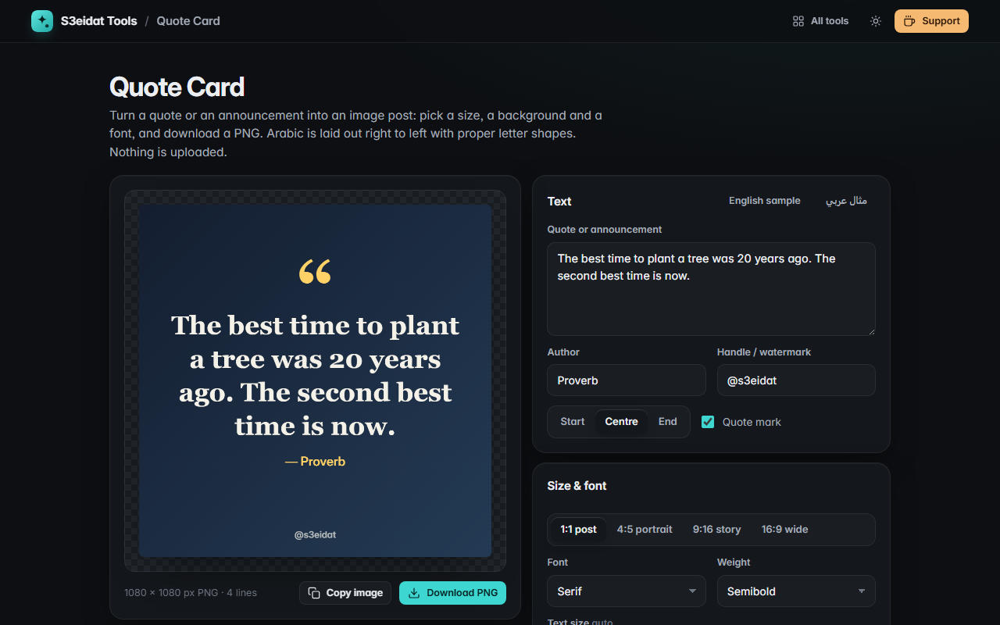

# Quote Card

> Turn a quote or an announcement into a shareable image post. Free, private, and it runs entirely in your browser.

### ▶ [Open Quote Card](https://s3eidat.github.io/quote-card/)



## Features

- **Sizes**: 1:1 post (1080 × 1080), 4:5 portrait (1080 × 1350), 9:16 story (1080 × 1920), 16:9 wide (1920 × 1080)
- **Backgrounds**: gradient presets or your own two colours and angle, a solid colour, or **your photo** with darken and blur
- **Fonts from your device**: sans, serif, rounded, typewriter, Arabic Naskh, Arabic sans, condensed; regular, semibold or bold
- **Text that fits**: automatic sizing (or set it yourself), line spacing, start / centre / end alignment, line breaks you type are kept, over-long words are split
- **Arabic and other right-to-left text**: direction comes from the first strong letter, lines are drawn right to left with proper letter shapes
- Optional quote mark, **author line** and **handle / watermark**
- **Export PNG** at full size, or copy it to the clipboard

## Privacy

Your text and photos never leave your device: the card is drawn on a canvas in your browser. Settings are remembered in local storage; photos are not saved.
There is no server, no account, no analytics. The page ships with a strict Content-Security-Policy
(`connect-src 'self'`), so the browser itself blocks any attempt to send data anywhere.

## Run it yourself

It's plain HTML, CSS and JavaScript with no build step:

```bash
git clone https://github.com/s3eidat/quote-card
cd quote-card
python -m http.server 8000
```

Then open http://localhost:8000.

## Support

If this saved you time, **[buy me a coffee ☕](https://s3eidat.github.io/coffee/)**. It keeps every tool free.

---

Part of **[S3eidat Tools](https://s3eidat.github.io/)**: 100+ free, private tools that run in your browser. MIT licensed.
